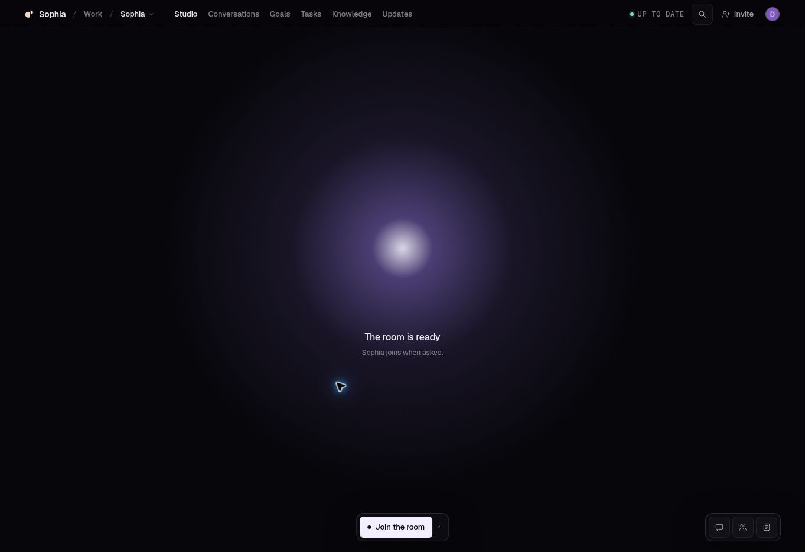
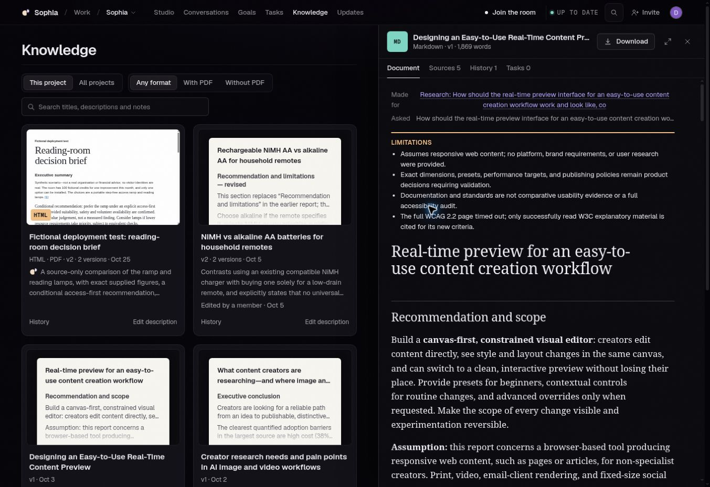
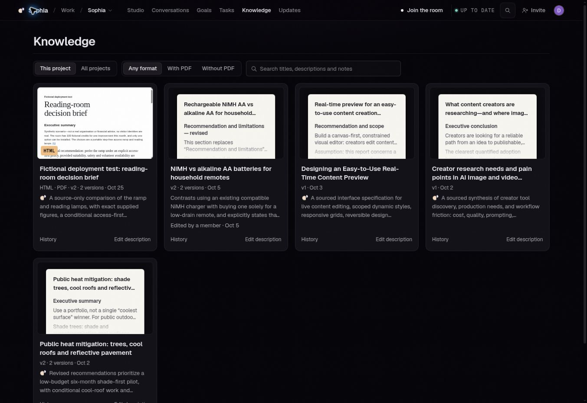
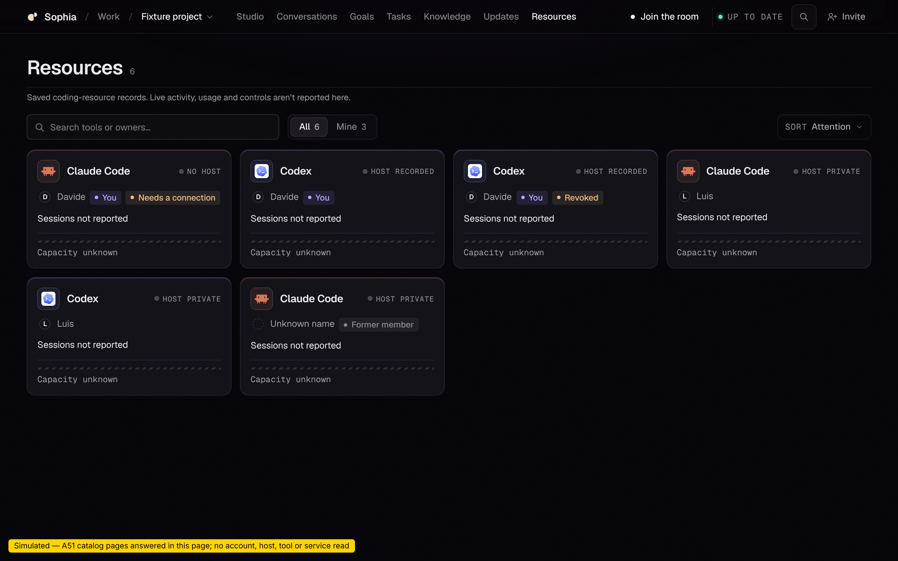
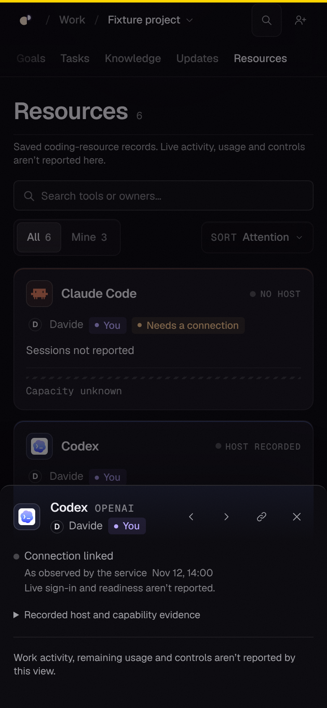

# Sophia

**Think together. Explore possibilities. Build with context.**

Sophia is a shared AI workspace for conversations, research and project work.
It brings the discussion, the work it produces and the decisions around it into
one place—so a promising idea can become something the team can inspect,
improve and build on.

[Open Sophia](https://studio.sophia-ei.com/) · [Inside the workspace](#inside-the-workspace) · [What comes next](#what-comes-next) · [Run locally](#run-locally) · [Documentation](docs/README.md)



*Current app · the project room at rest, captured 18 November 2026.*

**In active development.** The tour shows the deployed interface. Prepared UI
is labelled separately; the complete connected-resource workflow described
below is being delivered incrementally.

## Inside the workspace

### A room for thinking together

The room puts the conversation at the centre. Join when you want to meet;
open **Chat**, **People** or **Brief** when you need them. Project navigation
keeps the room within reach while you inspect work elsewhere.

**Personal** is your private space for notes and conversations. **Project
Conversations** keep shared discussions together, with their contributors and
project context visible. Carrying something into shared work is a deliberate
action. Sophia's ability to answer or act depends on the route enabled for
that space.

### Work you can open, question and keep

**Knowledge** collects research outputs as readable work: document previews,
versions, descriptions and available formats. Open a report to inspect its
content, sources, limitations and history in one viewer.



*Current app · an existing research report and its supporting context. The
library includes public-topic research and an explicitly fictional test brief.*

Reports can have Markdown, HTML and PDF outputs; the interface offers the
formats actually available for that item. A new version keeps the earlier work
available for comparison.

<details>
<summary>See the Knowledge library</summary>



*Current app · browse the collection before opening a particular result.*

</details>

### A clear place for each kind of work

| Surface | What it helps you do |
|---|---|
| **Conversations** | Return to a discussion and see the project context around it. |
| **Goals** | Understand the intended outcome, current state and decisions that need attention. |
| **Tasks** | Follow execution and open the work Sophia produces. |
| **Knowledge** | Find retained outputs and inspect their sources and versions. |
| **Updates** | Catch up on project activity and changes. |

These are views of the same project. The interface is designed to keep the
selected work prominent and reveal supporting detail when it is useful.

## What comes next

Sophia is evolving towards **three connected lenses over one project**:

| Lens | Intended experience |
|---|---|
| **Converse** | Think with Sophia and the team through text or voice. |
| **Explore** | Research, compare directions and develop artifacts or prototypes. |
| **Build** | Take an agreed direction into repository work, review and verified delivery. |

Converse is the current room experience. Research and artifacts are already
accessible through the work and Knowledge surfaces; the dedicated Explore and
Build lenses and their complete handover are still being connected.

### Your resources, with understandable limits

The next iteration connects **owner-operated Codex and Claude Code resources**
for repository work and **explicitly funded API routes** for exploration.
API funding and native subscription usage remain separate.



*Prepared UI · controlled fixture. This implemented resource catalog uses
synthetic records. It shows ownership and recorded connection information;
live activity, remaining quota and execution controls are not reported here.*

The programme is connecting this foundation to:

- **Natural input:** write what you need, with optional mentions; Sophia routes
  it without a mandatory action selector.
- **Sophia's project manager and agents:** one accountable project manager
  coordinates implementation, review and verification.
- **Editable resource choices:** automatic selection for new assignments, with
  supported model and reasoning-effort settings, user preferences and pins.
- **Bounded team contributions:** owners choose which projects may use their
  resources and under what limits. Unknown capacity stays unknown.
- **Continuity into delivery:** retain the chosen sources, decisions and
  artifact versions as exploration becomes repository work.

<details>
<summary>See the prepared resource sheet on a narrow screen</summary>



*Prepared UI · controlled fixture. Recorded connection information is distinct
from live account readiness; technical evidence stays expandable.*

</details>

See the [current implementation programme](docs/execution/2026-11-08-incremental/README.md)
for scope and delivery criteria. [Image provenance](docs/readme-assets/README.md)
records which views are deployed captures and which are prepared examples.

## How it fits together

Sophia keeps project state, decisions, permissions and results in the
application layer. Execution adapters connect the capabilities used for a
particular task; the Studio remains the user's workspace.

| Part | Responsibility | Source |
|---|---|---|
| **Studio** | React/Vite interface and shared UI components | [`apps/studio`](apps/studio), [`packages/ui`](packages/ui) |
| **API and state** | Fastify, authenticated commands, PostgreSQL records, Supabase Auth and replayable event streams | [`apps/api`](apps/api), [`packages/contracts`](packages/contracts), [`packages/persistence`](packages/persistence), [`db`](db) |
| **Execution** | Background work, a supervised DeepSeek Harness (`dsh`) runtime and Sophia's role/tool bundle | [`apps/worker`](apps/worker), [`apps/execution-host`](apps/execution-host), [`packages/dsh-bundle`](packages/dsh-bundle) |
| **Voice and presence** | LiveKit rooms and a separate media bridge | [`apps/media-bridge`](apps/media-bridge) |
| **Coordination and outputs** | Bounded coordination adapters, research reports, HTML design and PDF rendering | [`packages/coordination`](packages/coordination), [`packages/report`](packages/report), [`packages/design`](packages/design), [`renderers`](renderers) |

Paperclip has a [bounded operational role](deploy/paperclip/README.md). Native
runner integrations are being qualified behind Sophia's contracts. Runtime
versions and artifact identities live in the [runtime unit](docs/RUNTIME_UNIT.md).

## Run locally

Use **Node.js 24.21.0**, **pnpm 11.7.0**, a running **Docker** installation and
`curl`.

```bash
git clone https://github.com/davidelaverga/Sophia.git
cd Sophia
pnpm install --frozen-lockfile
pnpm build
pnpm dev
```

Open **http://localhost:5173**. The development stack starts the API on
**8787**, local PostgreSQL and LiveKit services, and synthetic development
identities. Personal replies use a scripted rehearsal companion. Live model
execution and Sophia's voice bridge require explicit configuration; the basic
start does not enable them.

Run `pnpm check` for the repository's ordinary gate. Database, browser and
hosted checks have additional prerequisites described in the
[contributor guide](CONTRIBUTING.md) and [runtime documentation](docs/RUNTIME_UNIT.md).
Keep credentials outside Git; use [.env.example](.env.example) and the
[Supabase setup guide](deploy/supabase/README.md).

## Contributing

Start with [CONTRIBUTING.md](CONTRIBUTING.md) and [AGENTS.md](AGENTS.md).
The [documentation index](docs/README.md) leads to the architecture, current
programme and retained implementation evidence. Older packs remain historical
references; they are not a statement of today's deployed capabilities.
