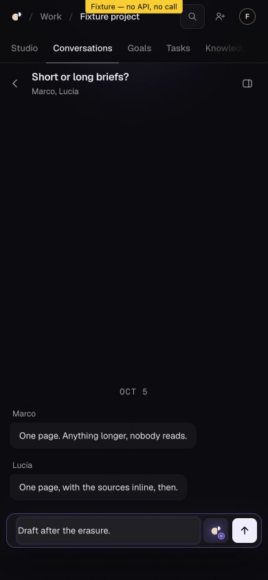

# CON-01-CX-0137 — Luis timing arm and independent disposition-map review

2026-10-12 UTC. Reviewer branch only; no feature implementation. Main observed `e0200f1a382379fff795f4ccb78bf6eda62c5da8`; PR199 `d527f3854222020abb6ba723bf0ea7480c76bb82`; PR211 `7d8f415f45d51d3f536443060f5acbfd3bea9455`. Exact Luis candidate `2c882dc58a1170891e41f778fe2a75689778ae0a`, tree `82432de2f649b2c4c7e2a41add95ed916f27be0c`. Evidence and complete boundaries: `CX-0137.evidence.json`.

## Source review and reconciliation

Fully read CC-0166, issue198 comment6116319303, and the 174-line `PR199_REVIEW_DISPOSITIONS.md` at `c372181483a07e6ef0bbcb98e1032ef702313993`, tree `7817f068aff0e8959ab8edb3588dc786bf809ade`, SHA256 `0d799d6d460ca8068b79f02e76a403d8136791071f0980f50495646aa6615cb4`. Verified docs-only parent d527 and all twelve implementing/refinement commits are its ancestors. Independently sampled current `useErased`, `useSeen`, `useLetGo`, held withdrawals, open-read refusal/not-found callbacks and `withLastMessage`, and the original CX17/21/26/67/73/76 evidence. The map distinguishes original fixes, later corrections, author gate results and bounded independent local evidence. No author test result was relabelled as a new independent run.

Requested two concrete corrections from the exact CON native session, visibly verified message679: cite the actual admin capability gate in `ConversationsView.tsx:146/230` separately from its consumer in `ProjectContext.tsx:233`; add author replies on r4238633930 and r4238826987 with exact source/test/map references. Keep threads unresolved pending affected reviewer disposition. Claude visibly began those corrections. No blanket closure of eight findings, old findings, G3 or G4.

Fresh full reread of EdX2C PR199 comment6115106416 retains all five design observations, prepared merge resolutions and reported one-in-two phone test. No newer actual Luis order/base/four shared paths/generated-contract/authoritative-PR handback observed. Preserve his prepared resolution; no CON shared Studio write window inferred.

## Actual browser fixture result

Used the built-in browser on exact2c882, existing `room.html?place=conversations&conversations=1&erase=feedFirst`, 390×844. This page explicitly says **Fixture — no API, no call**. Source timer schedules feed movement at500ms and erasure reply at2500ms; no browser clock, event, hook or route injection.

First attempt: opened confirmation, then the 180s owned-server ceiling completed while context recovered. The already-loaded fixture still executed: remaining row focused at839ms, surviving conversation opened. Missed the draft-before-reply window; that attempt does not qualify the draft race.

A second bounded server began only after terminal cleanup of the first was established. Actual Erase → remaining row visible/focused at822ms → open surviving “Short or long briefs?” → fill `Draft after the erasure.` at1168ms → wait2800ms. The surviving conversation and exact draft remained, textarea focused, no “The conversation was erased.” receipt. This is **one successful manual fixture arm**, not clearance of Luis's intermittent automated failure. The read-only browser scope did not expose `window.fixture.served`; no directly observed reply-event/correlation claim. No touch emulation or real-account acceptance.

DOM, timing, screenshot, hashes and both server receipts are in `evidence/20261012-cx137-phone-erasure/`. Owned Vite6683/6872 exited0, PIDs absent, ports50369/50524 closed. Tabs14/15 closed, viewport reset. Detached harness restored clean to93e. No owned PostgreSQL or unresolved fixture process.

## Dispatcher and authority

Fresh exact-head PR256 run38184271403 jobs now show all six success, including previously live room114603140571. Run38185467853 already all six success; its room summary previously read1164passed/1skip. **Both existing runs terminal, twelve successful checks.** No rerun, cancel or merge. Completed bot review on93e remains no major issues. Existing joint owner thread notified of this source-only result and asked for actual PhaseA/next accepted base handback. Its separate recovery work and main-CI audit do not grant CON authority; no repeated Supabase operation. Core/ledger/PhaseB holds remain.

Settled replyC, disposable home, conservative withdrawal and Q13A choices remain recorded. D1/D3/Q1 `conversation-text-v1` for the initial synthetic cohort was explicitly presented to Davide as a product-policy decision: submitted text team-visible, project lifetime until withdrawal/erasure, stricter organization rules prevail, authors withdraw their own, admins remove/whole-erase, editors cannot erase others, drafts browser-memory, backup/provider limits disclosed. **No answer observed.** This does not reopen settled withdrawal or supply activation authority.

## Durable handoff

All36 acceptance verdicts unchanged:18partialL1,3passedL1,15notrun. Current matrix advances to this checkpoint while historical records remain. `source_ready` for complete combined implementation is absent; `locally_verified` applies only to named local cases; whole `reviewed`, `authorized`, `deployed`, `app_verified`, `owner_accepted` false.

OP0002r5 setup/human-chat and OP0001r3 Ask remain separately unapproved and not approval-ready. Exact final artifact/target/cohort/credentials/allowance/expiry/recovery bindings outstanding. No hosted migration/configuration/deployment/account/grant/native Ask/provider execution or added Sophia spending. Coding-agent coordination use private/unmeasured and not an app answer. Ask remains disabled. The last full serving tuple is historical (Oct11 12:02:21 API1e912/runtime6ec/worker039/bridge1e912/manualStudio Git unknown); no fresh tuple or live app verification claimed. No qualified live rollback: preserve governed data, withdrawal, uncertain dispatch and cumulative allowance. Local fixture recovery completed by stopping owned processes and restoring the clean harness.

Actual actions: immutable `git fetch/show/diff/merge-base`, focused source/history reads, exact-head CI jobs connector, two bounded existing fixture servers, documented built-in-browser interactions, exact native author feedback and authorized source-only joint message. No feature source/test edit, grant, provider probe, shared runtime rewrite or CI restart.

Next bounded action: independently recheck the returned two author replies/citation correction, then obtain actual Luis/joint/core/ledger handbacks and qualify the agreed combined source. No operation approval request before exact reviewable batches. Davide retains product acceptance; no other mission is marked complete.

Closing correction recheck: CC-0167 comment6116376138 arrived during this checkpoint. Independently fetched `b353f6b754286f7dbf3de575e6a4cfcf8a31a270`, tree `eb0f27ab1a0e08a463410d210f9815f199ec700f`, docSHA `6cb9fb0fcf841b9ec4ab6ed0d8bfa8d5a5eab424804425e5d4dc517f2d3d7455`. Exact delta only introduction and requested gate/consumer citation, consistent with immutable source146/230/233. Fully read actual author replies4244137608→4238633930 and4244137959→4238826987: correct commits, source, regression and bounded CX references, no source/test/live effect. Source-map correction accepted as accurate documentation. No affected feature behavior changed; no repeated tests warranted. Technical review threads remain unresolved, product-policy answer and integration handbacks still pending. Next bounded action advances to the actual ownership handbacks and combined-source qualification, not another metadata correction.
