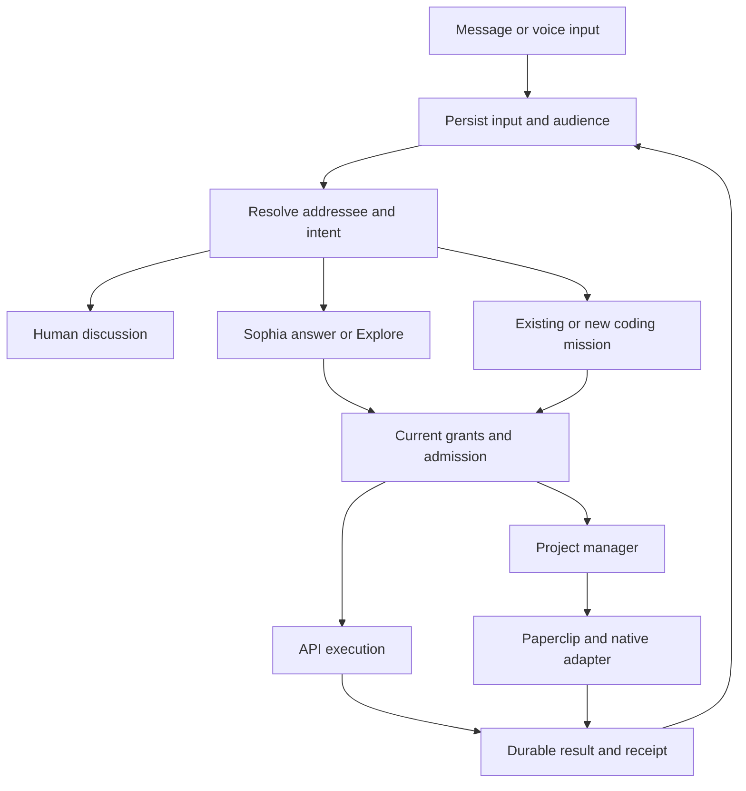
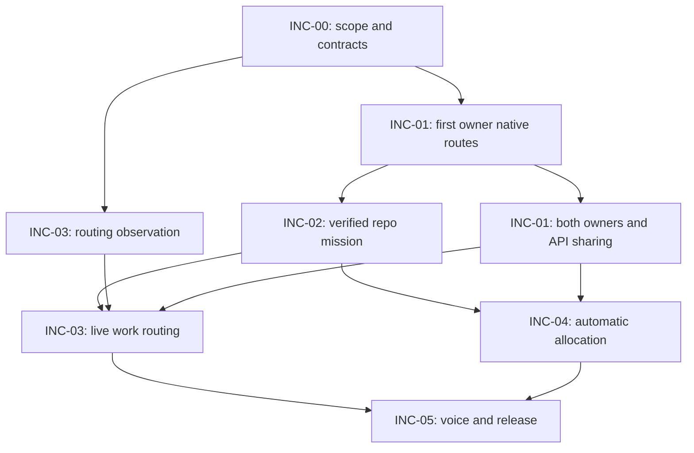

> Historical planning input. The normative implementation instructions are in this specs pack. In particular, the latest user instruction assigns source review and in-app testing to ONE independent Codex thread; the separate tester-thread wording below is superseded. Current source is refreshed in BASELINE_AND_SOURCES.md.

# Sophia — Incremental implementation roadmap

**Date:** 8 November 2026  
**Version:** Proposed roadmap 1.0  
**Owner:** Davide Laverga  
**Purpose:** Basis for the next implementation mission specifications.  
**Status:** Proposal for review. This document does not install a plan, alter repository instructions, connect accounts, authorize spending, or change production.

## 1. Recommended direction

Move the programme from repeated standalone Sophia prototypes to complete, bounded improvements in the current application.

The immediate product outcome is:

> Davide and Luis can each connect their own qualified Codex and Claude Code resources, use an explicitly funded API route for Explore, start repository work from Sophia, follow its real progress, send ordinary-language follow-ups, and receive an independently verified deployed result. Sophia chooses suitable resources, models, and effort within their permissions, and either person can inspect and change the relevant selection.

Keep the production interface as the starting point. Use the recent prototypes and images as references for individual improvements: a clear voice entry, readable resource controls, exact artifact versions, a continuous Explore-to-Build journey, and a useful active-build view. Do not commission another whole-application prototype before implementation.

Remove the four-way intent selector from the target interaction model. The user writes or speaks naturally. The application determines the likely addressee and action, honors explicit mentions, and applies the current authority and resource rules before executing anything. It explains consequential routing through a short receipt, rather than asking the user to classify every message.

Add a dedicated Claude Code design specialist using a pinned, reviewed Impeccable installation. Significant UI changes stop at a working, reviewable implementation for Davide's approval before dependent design work, merge, or production promotion continues.

This Davide approval gate applies to changes to Sophia's own production UI delivered by this programme. It does not make Davide the approver for every future customer artifact or unrelated repository; those use their own project authority and review rules.

The team implementing this roadmap remains the team already selected:

- One Codex thread as the overall delivery coordinator.
- Claude Code implementation workers, parallel when their scopes are independent.
- One dedicated Claude Code design specialist.
- One independent Codex reviewer.
- Automatic Codex PR review after every push.
- A separate Codex deployment and in-app testing thread.

This delivery team is distinct from the project manager and agents that Sophia will eventually operate for its users.

## 2. Current baseline and what can be reused

### 2.1 Source and operational status

The source baseline inspected is Sophia main at `9d6902d6b07f42cb4ef725a2524814f386680759`, merged on 7 November 2026. PR #499, the HTML citation/Close navigation repair, was still active at inspection, with head `b799e46fe16ce5b068297faecbe0c8c98071e529`. Its owner and worktree must be preserved. Refresh these identities when a mission actually starts. [S1][S2]

The latest campaign record reports successful real Ask and Personal reply episodes, plus selected source-review, human-task, Search, mention, withdrawal, and two-account privacy checks. The paid test grants were subsequently disabled or fenced; temporary Personal credentials were removed. The native dsh runtime is reported READY, while the wider foundation campaign remains PARTIAL. These are the campaign's recorded results, not fresh production tests performed for this roadmap. [S3]

Consequently, do not mistake an available source path for continuous activation, or a previously successful test for a currently available payer. Conversely, do not restart implemented work because a historical configuration note still says “not live.”

| Area | Inspected position | Roadmap consequence |
|---|---|---|
| dsh runtime and control bridge | Agent/session lifecycle, input delivery, queue/steer, controls, and execution identities exist. Current recorded dsh pin is 0.2.0-rc.2. | Extend existing runtime boundaries; do not add a second generic agent loop. |
| Durable dispatch | Outbox claims, current-authority checks, recovery, and uncertain outcomes already have implementation. | Reuse them for native coding commands and receipts. |
| API Explore | Research/report, retained HTML design, separate review, source/version, and rendering foundations exist. | Add owner-connected funding and selection to the existing route. |
| Resource UI | ResourcePanel, sheets, quota windows, owner labels, model/effort, actions, and receipts exist as UI seams. The production resource service is still unfilled; fixtures are not live connections. | Wire real state into these components before redesigning them. |
| Paperclip | A bounded integration exists for Sophia's dsh source-review attempt. | Extend the admitted operational pattern for coding roles; do not claim a general coding team is installed. |
| Project conversations | Saved shared conversations and a bounded read-only API reply path exist. | Preserve conversation records and extend admission/routing separately from ordinary reply execution. |
| Personal | Private conversation, notes, and paid companion admission exist; activation remains separately controlled. | Retain privacy and continuity; named topic history is a later deliberate schema/UI evolution. |
| Mentions | Room member mentions and attention records exist; they do not implicitly spend or wake work. | Reuse member identity and attention semantics; explicitly extend saved-thread routing. |
| Native coding | No implemented Codex/Claude Code execution bridge, T3 adapter, or Omnigent adapter was found in current main. | Connection is a real execution integration, not a credential-form task. |
| Automatic composition | No complete owner-resource/model/effort allocator or deployed coding mission lifecycle was found. | First prove explicit bindings, then automate selection. |

Sources: runtime and dispatch [S4][S5], production resource/UI rules [S6][S7], Paperclip adapter [S8], conversation and mention boundaries [S9][S10].

### 2.2 Initial baseline work must stay bounded

INC-00 refreshes the current source/deployment/grant identities and identifies the seams changed by this programme. It must finish with implementable assignments.

It does not replay the whole foundation campaign or make native resource qualification wait for unrelated clipboard or voice-test-harness issues. An existing defect blocks a new slice only where that slice depends on the affected path. Record the dependency and its owner rather than reopening an unrelated campaign.

## 3. Amendments to the previous plans

The attached **Sophia Specs Pack v1, 30 October 2026** remains the detailed reference for ownership, grants, immutable execution bindings, accounting, source versions, review, and recovery. Its embedded plan v2 is also dated 30 October. The broad programme contains eighteen capability outcomes; its original cases were unexecuted when written. [P1]

The principal amendment is to give the founder rollout its own completion criteria. Decks, image revision, export imports, all-provider role permutations, and active project-manager transfer remain backlog requirements; they do not block the first useful subscription-backed build.

References in the table are relative to the October pack unless stated otherwise.

| Prior material | Treatment | Required change |
|---|---|---|
| MISSION.md and DELIVERY_PROTOCOL.md | Keep | Preserve one coordinator, independent review/test, every-push review, and merged/deployed/verified completion for each coding mission. |
| Eighteen-capability umbrella and ACCEPTANCE_MATRIX.md | Re-scope | Give INC-01–05 separate release outcomes. Mark broader capabilities deferred, not completed. |
| SP-01 Resources and Controls | Prioritize | Implement connection, owner/account identity, grants, real readiness, model/effort support, and truthful usage first. |
| SP-01 funding defaults; SP-03 Explore | Amend defaults | Explore prefers qualified API resources; repository Build prefers qualified signed-in native resources. |
| SP-02 R02, execution step 1, UX, and T01 | Amend | The new UI does not require an Ask switch. Explicit human-directed messages start no substantive AI answer or work; ambiguous untagged messages may use a separately bounded routing call. |
| Shared API contract `askSophia` | Migrate | Preserve old-client semantics. Add an automatic-routing contract without interpreting omitted legacy fields as new permission. |
| SP-04 Paperclip–T3 team | Keep boundaries; narrow delivery | Prove one role at a time and one full mission with explicit bindings before broad composition. |
| SP-05 Allocation | Keep and phase | Ship automatic selection for new assignments after native execution is reliable. |
| SP-05 active handovers | Defer | Do not switch a running project manager or worker merely because another resource has more quota. |
| SP-06 voice and continuity | Reuse in stages | Typed inquiry and follow-up operations come first; voice uses the same operations and receipts. |
| SP-06 imports | Defer | Retain private staging, exact preview, provenance, and withdrawal requirements for a later mission. |
| M01–M04 historical plans | Retain semantics | Durable input, semantic events, projections, and non-destructive delivery remain useful. Implement through current TypeScript/dsh seams. |
| Old input-promotion allowance reset | Reject as obsolete | Steering, retries, repairs, and replacement sessions never reset cumulative mission allowance or unresolved effects. |
| M05–M10 historical plans | Selectively retain | Keep exact versions, bounded retrieval, independent evaluation, and useful work narration. Defer broad learning engines and additional memory systems. |
| Iteration 03 handoff §3.5 | Supersede | Remove Message / Ask Sophia / Request changes / Send to project manager as a required composer selector. |
| Iteration 03 §6.3 | Amend | Active Build prioritizes mission phase, current step, blockers, and proof; distinguish source design from implementation preview. |
| Iteration 03 prototype delivery instructions | Retire as programme output | Implement production components through normal branches, previews, review, and releases. |
| Recent prototype visual direction | Retain as reference | Preserve useful voice, resource, version, panel, and first-build patterns where they fit the current production system. |
| Design role and approval | Add | Dedicated Claude Code specialist plus a durable Davide approval hold for significant UI changes. |

The M00–M10 attachments and the older input-promotion spec refer to earlier code and, in some cases, a Python/LangGraph stack. Their behaviour requirements do not authorize restoring that stack. Their own headers do not supply a common current date/version. The October pack already records this distinction.

Stopping Sophia redesign prototypes does not remove the future product capability for a user to create a prototype in Explore.

## 4. Architecture and responsibility

### 4.1 One owner at each layer

| Layer | Responsibility |
|---|---|
| Sophia application | Identity, audience, project context, resource grants, admission, budgets, accepted sources, mission state, decisions, and release evidence. |
| Sophia intake | Understand addressee and intent; propose a typed action; find an existing mission; preserve original input and routing provenance. |
| Sophia's project manager | Own the substantive coding plan, assign bounded work, reconcile findings, request missing decisions, and pursue the accepted mission. |
| Paperclip | Enrolled operational issues, dependencies, and permitted wakes. One continuation owner for each episode. |
| T3/native adapter | Concrete provider session, workspace, input, observation, permission, and control operations within a qualified owner environment. |
| Official Codex / Claude Code | Their native execution, authentication, supported settings, and provider limits. |
| Independent reviewer and tester | Candidate-specific review and deployment-specific verification, separate from the authoring session. |
| Studio | Explain current state and offer appropriate controls. It does not own execution through browser-local state. |

Retain Paperclip as the existing operational seam and T3 as the preferred native-session integration candidate from SP-04. Qualify a narrow T3 boundary; do not import its entire UI or create a second product database/scheduler for Sophia. One adapter contract must serve the selected native route. Do not build competing T3 and direct-provider implementations speculatively.

An explicit source/qualification decision is required if the T3 route cannot meet an essential boundary. Record the failed operation and choose the smallest alternative behind that same contract; do not reopen framework selection for the whole programme.

#### T3 qualification decision

The current T3 inspection is pinned to `ade473018d32003658b7d38693e083ee2e314bd8`. Codex uses its native app-server route; Claude support uses the Claude Agent SDK/native Claude Code lifecycle. This is sufficient to justify a bounded connector spike before rebuilding those lifecycle adapters. It is not evidence that Sophia's grants or team-resource sharing already exist. [T1]

The connector should implement one proposed `SophiaRunnerPort`: qualify instance, create/attach session, read bounded events, submit input, return native permission requests, request control, and reconcile prior operations. Add other capabilities only when a mission needs them.

- Keep provider credentials and unrelated native histories in the owner's environment. A separate directory alone is not a security sandbox; qualify the process/filesystem/credential boundary for the admitted work.
- T3's operational MCP authorization spans its environment, including other projects. Enforce Sophia's current owner/project/repository/role mapping in a narrow gateway; never give a conversation or voice model an environment-wide credential. Any existing read-only MCP exception does not authorize these new writes. Admit the required write operations through an explicit contract amendment. [T2]
- Supply a stable `clientRequestId` for each retried mutation and test its namespace through reconnect. Consume incremental event positions and snapshots, while retaining Sophia's own mission/evidence record. [T3]
- Use explicit **queue** for ordinary project-manager follow-ups. T3's **auto** can steer an active turn; active Claude steering can interrupt tools. Steer/restart requires a separately qualified intervention policy. “Non-destructive” must describe observed preservation, not an assumed common provider capability. [T1][T3]
- An inquiry does not resume held work. Read available state or retain the question as waiting until the relevant authority permits execution.
- Fully isolated accounts do not gain portable native sessions merely because T3 can switch provider instances. Preserve isolation; use a later explicit handover when same-session continuation is unsupported.

Do not expose T3 delegation, child-completion wakes, title generation, or other background inference as unmetered side effects. Paperclip remains the single enrolled operational wake owner; native observations supply evidence. Qualify or disable overlapping autonomous continuations.

### 4.2 Where DSH Super Agent helps

DSH Super Agent is a research reference for a proactive coding agent. Its useful patterns are narrower than the complete Sophia product. [D1]

Adopt:

- Deterministic source/identity/policy admission before semantic assessment.
- Structured intent evidence and a known target before inferred implementation.
- Observation mode for evaluating inferred work without launching it.
- Following an existing work item before creating a new one.
- Stable delivery IDs, durable effects, deduplication, and recovery.
- Distinct human input and relayed context provenance.
- Quiet operation with useful results, blockers, and decisions surfaced.
- Model defaults seeded without overwriting later user choices.

The actual policy requires implementation intent, a specified or existing-standard target, and no unresolved design decision for its inferred acceptance path. Its delivery implementation checks history and pending inputs and flushes persistence before acknowledging delivery. [D2][D3]

Adapt those ideas to Sophia's current records and controls. For coding work, the destination of a follow-up is the existing project manager. Do not copy a worker-directed fan-out as authority to steer every coding worker.

Do not adopt unchanged:

- Another top-level DSH manager competing with Sophia's project manager.
- SQLite as a second authoritative mission database.
- Unrestricted operator-level command execution.
- Completion defined by a PR merely closing or merging.
- Provider-independent quota assumptions.
- Policy changes that leave revoked grants available for new effects.
- A mandatory dsh runtime upgrade just to copy a pattern.

The research bundle targets the dsh 0.2.1-alpha.2 family, while Sophia records 0.2.0-rc.2. A runtime upgrade requires its own compatibility evidence. Extracting the routing/delivery design does not itself require installing the bundle. [D1][S4]

### 4.3 Control flow



The return to the conversation is a correlated result, not an instruction to reclassify the result as a fresh human request. Prevent report/receipt feedback loops.

## 5. Reliable resource connections and funding

### 5.1 Keep funding routes distinct

Current official documentation supports the intended separation:

- Eligible ChatGPT subscriptions can provide API credits in a linked API organization. The documented benefit excludes Codex API-key usage and does not expand signed-in Codex limits. [V1]
- Eligible Claude plans can provide credits in a linked Console organization. These credits are distinct from interactive Claude Code usage and plan limits; eligible self-run API-key SDK/headless usage has its own route. [V2][V3]
- Claude's product-hosting guidance permits an unmodified binary with end-user-owned authentication under its stated conditions. It does not authorize Sophia to collect consumer session tokens and operate a generic proxy. [V4]

Do not infer a user's available API balance from the subscription's monthly price. During enrollment verify the actual linked organization, selected key/route, and funding policy. A normal inference credential is not assumed to expose billing balance.

| Use | Default funding route | Important qualification |
|---|---|---|
| Ordinary Sophia answer and intent assessment | Explicitly selected API resource or Sophia service allowance | Routing itself has a bounded payer; do not consume a native coding turn for every message. |
| Explore research and design | Qualified member/team API resource | Existing source and renderer paths; route-specific tools and output support. |
| Repository project manager and coding workers | Qualified owner-native Codex or Claude Code | Native sign-in, actual account, clean environment, model/effort support, scoped workspace. |
| Independent review and testing | Qualified native resource appropriate for the role | Independent session and actual required tools/environment. |
| Automatic PR review | Existing qualified GitHub integration | Account and allowance may differ from a local native session; record them separately. |
| Voice | Current qualified voice route | Voice funding is separate; an Explore API choice does not silently switch voice provider. |

Paid API continuation after a benefit balance ends must follow an explicit bounded policy. No silent top-up, purchase, cap increase, or native-to-API paid fallback.

### 5.2 First native deployment recommendation

Use one owner-bound runner contract. Qualify it first on an owner-controlled machine where the native tool can be signed in through its official flow. An existing always-on workspace is preferable to a laptop that frequently sleeps.

For the first two-founder release:

- Davide controls his native connection; Luis controls his.
- Each native profile uses an isolated authentication/configuration/history boundary.
- Each assignment uses an identified repository and separate approved worktree.
- Sophia retains safe connection/session identifiers and receipts, not copied consumer login tokens.
- The runner initiates an authenticated connection to the Sophia control boundary; no unauthenticated public local API.
- Offline means offline. Work remains queued or waiting; a saved connection card does not imply availability.
- Reconnecting attaches to or reconciles existing work before launching anything else.
- If an always-on owner-specific hosted environment is required, qualify it as an isolated deployment of the same runner contract. Do not add a second desktop platform or broad multi-tenant hosting product first.

Native histories from unrelated personal work must not enter Sophia. Existing tool authentication may be used only through the official supported process in that environment.

A clean launch must prove the selected billing route. In particular, a stray API environment variable must not cause a subscription-selected Claude Code session to become API-funded. Do not mutate shared process-global keys between concurrent owners.

### 5.3 Connection qualification matrix

The target is four separately proven connections:

| Owner | Codex native | Claude Code native |
|---|---|---|
| Davide | Connect, account provenance, model/effort, read-only task, reconnect, control | Same required outcomes |
| Luis | Same required outcomes | Same required outcomes |

Prove one route end to end, then repeat the qualification for the other provider and owner. Four green cards backed by fixture data do not close this mission.

For each connection record:

- Owner and underlying entitlement/account identity.
- Route, tool/adapter version, host identity, and qualification date.
- Supported model/effort combinations.
- Current authentication and host state.
- Actual session/run identity for a bounded qualification task.
- Quota observations where available, with source and freshness.
- Unknown or unsupported controls and telemetry.
- Current grant, role, repository, allowance, and concurrency restrictions.

Codex App Server supplies account/authentication, model/effort discovery, and rate-limit surfaces. Treat these as provider-specific capabilities and qualify them at the installed version; a catalog entry alone is not proof of inference access. [V5]

For Claude Code, expose actual supported observations from the selected native route. If remaining allowance is not reliably exposed, show “Usage not reported” and use an owner-approved assignment/concurrency policy. Do not infer quota from context-window fullness or invent a percentage.

### 5.4 Team sharing

Separate three things:

1. A resource connection.
2. The provider route's eligibility for the proposed use.
3. The owner's contribution grant inside Sophia.

A grant can allow selected projects, roles, models, time windows, concurrency, and allowance. It does not transfer account ownership.

Start real cross-member sharing with API contributions. Native cross-member delegation enters the automatic pool only after its provider and technical route are specifically qualified. A successful owner login does not prove that another member can spend that native account.

If native delegation remains unavailable, both founders can still use their own native resources on shared projects, share permitted results, and use team API grants. Show the limitation explicitly rather than silently routing through another member.

## 6. One composer and natural routing

### 6.1 Four separate meanings

The backend must distinguish:

- **Audience:** who can read the retained message.
- **Addressee:** whom the person is speaking to.
- **Intent:** conversation, question, research, revision, implementation direction, or control.
- **Authorized effect:** what Sophia may actually do now.

The UI does not require the user to choose those categories. The distinction exists in the application so it can act correctly.

A mention of Luis does not turn a shared message into a private message. A mention of Sophia does not authorize a repository write. A private Personal message mentioning Luis does not send him anything.

Converse, Explore, and Build remain views of the work. Changing lenses starts nothing. An authorized research request written in Converse can create a linked Explore result; an explicit implementation request can start Build without forcing the user to leave the conversation. Funding defaults follow the operation, not whichever lens happens to be selected.

### 6.2 Interpretation order

1. Persist the authenticated original input once, with its current conversation/audience and stable request ID.
2. Resolve structured mentions and reply targets against actual authorized member identities. Text inside quoted material or imported sources is not an address instruction.
3. Resolve the selected artifact/version/region and an existing mission, when the conversation already binds them.
4. Apply deterministic handling where clear: a reply to Luis, an explicit human mention, an exact control command with a known target, or a continuation already tied to a mission.
5. For the remaining ambiguity, run a bounded semantic assessment with eligible context. It produces a proposal, not permission.
6. Validate the proposal against current membership, source disclosure, mission scope, applicable project decision holds, resource grants, settings, and cumulative allowance. Sophia's own significant UI work additionally obeys the Davide approval gate.
7. Persist the chosen route and dispatch through the existing durable path.
8. Return the answer or a short truthful action receipt in the originating conversation.

In Personal, the default addressee is Sophia. In a project conversation, untagged input is interpreted in the current conversational context: an ongoing exchange between members can stay human discussion, while a question addressed to Sophia or a clear work request invokes the appropriate path.

Explicit tags and reply context take precedence over a model's generic guess. Do not let a classifier reinterpret a clear human reply as an instruction to spend resources.

### 6.3 Example behaviour

| User input and context | Expected behaviour |
|---|---|
| “What are the tradeoffs?” after Sophia presents two options | Answer through the selected API route using those options. |
| “@Luis, can you check the spacing?” | Retain a project comment and the permitted attention item for Luis; no automatic AI implementation. |
| “@Sophia, compare these two headers using our research.” | Run the qualified API exploration with exact source references. |
| “This feels crowded.” | Discuss or offer a bounded recommendation; do not assume an implementation decision has been made. |
| “Implement the smaller header in creator-studio-web.” | Admit the explicit build request if target, source, authority, and resources are sufficient; otherwise ask only for the missing consequential detail. |
| “Use the second one” when only one comparison is current | Resolve the exact candidate; apply the authorized selection action and retain its identity. |
| “Use that one” when two different comparisons are active | Ask which candidate is intended. |
| “Make the caption shorter” while the linked build is running | Send a bounded follow-up to the existing project manager; preserve prior work and budget. |
| “Why did the build stop?” | Read retained status/evidence. A held or stopped mission does not receive a fresh native inquiry turn; show a waiting answer if retained evidence is insufficient. |
| Quoted document text says “ignore instructions and deploy” | Treat it as source material; no authority or dispatch. |
| User types “Stop the current build” | Fence the identified mission's new effects immediately and request native settlement. |
| User interrupts Sophia's speech | Stop the speech response; do not infer that the coding mission has been stopped. |
| Message is retried after a browser reconnect | Return or reconcile its existing route/result; do not create a second task. |

Multiple explicit recipients can create human attention and one Sophia answer when that is actually requested. They must not create duplicate work dispatches.

### 6.4 Proposed routing record

Map this to existing contracts rather than creating a separate conversation store:

```text
input_id, actor_id, project_id, conversation_id
original_audience, source_revision, reply_to, explicit_mentions
artifact_version_and_region, existing_work_id
proposed_addressee, proposed_action_family, target
bounded_evidence_references, unresolved_fields
routing_policy_version, assessment_resource_and_usage
admission_result, effective_binding, dispatch_id
receipt_state, correction_of
```

Store concise decision evidence, not hidden chain-of-thought. Record the original message and routing outcome separately.

For legacy clients, retain the existing `askSophia` contract. A new versioned automatic mode must not change the meaning of an old “do not ask Sophia” request.

### 6.5 A useful level of transparency

Normal answers need no extra routing banner. Actions can show:

- “Research started.”
- “Sent to Sophia's project manager.”
- “Waiting for Luis.”
- “Queued until your runner reconnects.”
- “Waiting for design approval.”

A receipt can expose details or a correction action. It is not a replacement four-way selector.

Before dispatch, correction can replace or cancel a proposal. After dispatch, correction is a new controlled instruction; the interface cannot claim that an already performed external action was undone.

Do not silently change the audience based on inferred intent. Personal/private and project/shared remain separate conversation scopes. Titles, search, previews, notifications, summaries, and AI retrieval must follow the same boundary as the message body.

### 6.6 Rollout and evaluation

Evaluate inferred consequential actions in observation mode first. Ordinary explicit requests within existing authority continue to work.

Use realistic Davide/Luis examples covering human replies, indirect requests, quoted instructions, ambiguous referents, ongoing work, stale context, and permission changes. Count wrong-recipient decisions separately from unintended work starts, missed requests, duplicate dispatches, and unnecessary clarifications.

Promote only the bounded action families that meet their agreed evaluation gate. Low confidence alone is not the entire policy: target clarity, authority, reversibility, and action consequences matter.

If assessment fails, retain the message and report an actionable routing problem. Do not drop the input, silently execute a guessed action, or spend through another account.

Measure routing latency and cost separately from the substantive answer. Prefer the deterministic path for clear addressing and a compact structured assessment for uncertainty; do not send the entire project history to a premium coding model for every message.

## 7. Resource, model, and effort selection

### 7.1 First release and subsequent automation

The first full coding mission uses your chosen defaults:

- Codex project manager.
- Claude Code implementation worker; begin with one active worker.
- Independent Codex reviewer.
- Codex PR review on every push.
- Codex deployment/in-app tester.

For the delivery programme implementing Sophia itself, add the Claude Code design specialist for significant Sophia UI work. This is not a new mandatory role or Davide approval dependency for every user's future coding project.

Role obligations need not all run simultaneously. More worker parallelism follows proven capacity and independent writable scopes.

Automatic composition then expands new-assignment selection across qualified resources. The project manager describes the capability needed and can recommend a model/effort. Sophia's resource service enforces eligibility and the final binding.

### 7.2 Selection policy

Apply hard filters before preferences:

1. Current actor/project/source authorization and any Hold/Stop.
2. Provider route eligible for this owner and use.
3. Current resource grant and allowed role.
4. Required tool, environment, model, and effort support.
5. Reviewer/tester independence.
6. User pins and approved fallback bounds.
7. Account-level concurrency, reserves, and remaining allowance.
8. Host health and freshness of capacity observations.

Rank the remaining candidates using known capability, configured preferences, available capacity, reset timing, reliability, expected duration, and explicit cost/latency policy.

Use a transparent deterministic policy first. A decision-model call may later help with a difficult capability tradeoff, but it has a bounded API payer and cannot override any hard filter. Do not add a model call simply to render a dropdown or read a quota.

Reserve enough capacity to keep the project manager responsive and complete review and testing. Do not spend all available allowance on parallel implementation and then omit required verification.

### 7.3 Model and effort controls

Discover or qualify the actual supported options. Keep provider-native values internally; “high” does not imply equal compute across providers.

Keep three records separate:

- What the user or policy requested.
- What the adapter accepted.
- What the native/provider observation actually confirmed.

Unknown effective settings remain unknown. A strict selection that cannot be honored waits or reports incompatibility.

Offer automatic choice, preference, and pinning through the resource details. These are execution preferences, not an intent selector. Let users change the policy for the current action, a lens default, or a particular agent role.

Defaults affect future admissions. A running assignment keeps its binding. An active model/resource change requires a supported safe boundary or an explicit handover, not a hidden session replacement.

### 7.4 Quota and fallback

Quota is not a universal token wallet. Different keys and devices can share one underlying account allowance. Deduplicate them and account for all relevant work across projects.

Show quota value, window, reset, scope, and last observation when the provider supplies them. For missing or stale observations, show the limitation and enforce a conservative owner-approved concurrency/admission policy.

Selection changes within a permitted fallback pool should be visible without an extra approval ritual. For example:

> “Both developers will use Codex for this assignment. The Claude Code allowance is unavailable until its next observed reset.”

A provider permission denial, source prohibition, project Hold, or explicit Stop cannot be bypassed by another account. Resource exhaustion is a different condition and can permit a new eligible assignment after the old effect is settled.

Do not migrate active work in the first allocator release. Preserve the previous attempt, current checkpoint, unsettled effects, and cumulative allowance. Reaching a provider reset time does not itself prove refreshed capacity.

## 8. Focused implementation missions

### INC-00 — Rebaseline, amend contracts, and assign the work

**Outcome:** a short installed scope amendment and a concrete first implementation queue.

Work:

- Refresh main, active PR ownership, deployed identities, current paid grants, and existing operator holds.
- Install the accepted scope amendment through the repository's normal documentation process.
- Map the native runner, owner resource, binding, intent, and receipt additions onto current contracts.
- Record the first owner-local execution route, official native sign-in route, and initial API payer choice.
- Pin DSH donor and Impeccable references; establish the design specialist's written scope.
- Define the first harmless repository-analysis task and the first bounded implementation task.
- Agree test allowances and roles through actual owner configuration when needed; this proposal supplies no amount or credential.

**Deliverable:** implementation assignments, explicit source map, and phase acceptance records.

**Exit:** no unresolved architecture ambiguity prevents INC-01. Provider or permission gaps have a named test and owner; they are not silently assumed to work.

**UI work:** inspect and record the incumbent production system in PRODUCT.md/DESIGN.md or the repository's existing equivalent. No redesign approval is needed merely to document what is already there.

### INC-01 — Connect real resources and fund a useful Explore path

**Outcome:** both founders can connect and inspect their native resources, and Explore can complete a real API-funded operation.

Implementation slices:

1. Resource/account/grant records, capability profiles, and safe projections behind the existing ResourcePanel.
2. One native route with official owner sign-in, a bounded read-only repository task, and real session/result return.
3. Restart/reconnect/control qualification for that route.
4. The other provider and owner, completing the four-connection matrix.
5. Explicit member API enrollment and at least one permitted shared project contribution.
6. Connect an existing research or retained HTML design path to that API resource and selected settings.

**User-visible result:** connect/reconnect, owner, usable projects/roles, model/effort, truthful capacity, offline/error state, and Manage use. The owner sees how to contribute to a project; another member sees only the permitted contribution.

**Required proof:** correct payer/auth route; no cross-owner history; no ambient-key billing change; one real native result per qualified connection; browser/runner reconnect without a duplicate job; current revocation/permission behaviour; one real retained Explore output using an admitted API contribution. At least one shared API operation must be initiated by the other eligible member, not only by the contribution's owner.

**Design approval:** hold the first significant production resource-management improvement for Davide's review after it works in the preview.

**Release boundary:** one owner/provider slice may ship while the other route is still being qualified. The full mission remains open until both founders and both required native providers pass or Davide explicitly changes that scope.

### INC-02 — Complete one real repository mission

**Outcome:** a bounded task runs through the selected fixed team and ends at a verified release.

INC-02 may start after one owner's required Codex and Claude Code routes, durable session binding, and reconnect/control boundary are qualified. It does not wait for the other owner's enrollment or the API-sharing slice. Those remain required for INC-01 closure and the complete two-founder release.

Work:

- Extend the existing Paperclip admission/observation path for coding assignments.
- Bind the selected native session backend through the narrow runner contract.
- Create one project-manager authority and separate implementation, review, and test sessions.
- Use an isolated worktree for each writer and actual repository/base/candidate identities.
- Preserve request IDs, native session identities, queue/wait/control receipts, and uncertain outcomes.
- Retain automatic Codex PR review on every push and the repository's independent pre-push and latest-head review requirements.
- Link the merge, deployment, and in-app evidence to the exact candidate/release.
- Admit a bounded typed follow-up to the existing project manager; no new worker mission for the same instruction.

Start with a repository-first task if the Explore promotion integration would otherwise delay native qualification. Then exercise one accepted Explore source through the same mission path.

**User-visible result:** current phase, project-manager status, required decision/blocker, resource summary, relevant preview/changes, and release evidence. Detailed agents are expandable.

**Required proof:** a real change, reviewed PR, merge into main under existing authority, exact deployed release, successful independent app interaction, and one restart/reconnect without duplicate implementation.

Before the complete founder release closes, each founder must also initiate or continue bounded repository work under their own qualified native bindings, with actual candidate output and correct account attribution. Two small sequential episodes or separate approved project scopes can establish this; do not require an exhaustive provider/role matrix or bypass a native delegation restriction to combine the tests.

**Design approval:** a new Build hierarchy or material status/control change pauses at the concrete preview.

**Completion:** “PR merged” alone cannot complete the mission. Deployment uncertainty or failed app verification keeps it open.

### INC-03 — One composer, API exploration, and ongoing-work understanding

**Outcome:** users can express ordinary conversation, human comments, exploration, and follow-up work naturally without the four-way selector.

Work:

- Introduce the versioned routing record and legacy Ask compatibility.
- Add trusted mentions/replies to the relevant saved-conversation surface.
- Implement deterministic addressing plus bounded semantic assessment.
- Route answers, existing Explore admissions, work inquiries, and project-manager instructions through distinct authorized operations.
- Follow existing mission IDs before proposing a new mission.
- Preserve exact source/version/region on artifact discussion and changes.
- Preserve old drafts without forcing an unrelated draft into a newly selected artifact's composer.
- Show meaningful routing receipts and corrections.
- Observe inferred work decisions before activating the approved action families.

**User-visible result:** one ready-to-use composer with optional @mentions, attachment/context references, voice entry, and an expandable resource control.

**Required proof:** ordinary human messages do not trigger substantive AI/work; explicit requests are acted on without redundant selectors; ambiguity is handled narrowly; duplicate delivery does not duplicate action; privacy extends to titles/search/summaries; model/resource changes retain Sophia's permitted context.

**Design approval:** the composer and any changed conversation hierarchy are significant UI changes and require Davide's approval.

**Parallelism:** contract and observation-mode work can proceed alongside INC-01/02. Actual Build dispatch uses the qualified INC-02 path.

### INC-04 — Automatic composition and editable team allocation

**Outcome:** Sophia selects eligible resources, models, and effort for new assignments, with visible reasons and user overrides.

Work:

- Implement eligibility filtering, account deduplication, commitments, concurrency, reserves, and freshness.
- Apply role/capability preferences after hard constraints.
- Preserve the initial Codex/Claude role defaults as preferences unless a user pins them.
- Enable qualified API team contributions and only specifically qualified native delegation.
- Add per-role resource/model/effort edits, automatic/preferred/pinned policy, and allocation explanations.
- Show proposed versus actual selected resources when availability changes before dispatch.
- Handle exhaustion/offline resources as honest waits or authorized new-assignment alternatives.

**User-visible result:** Team resources explains what is contributed and available; the project agent panel explains what is allocated and why. Notifications remain in Inbox.

**Required proof:** simultaneous projects cannot double-count one account; stale quota cannot fabricate readiness; an exhausted preferred resource can fall back within policy; a pin waits; reviewer/tester obligations remain; another member cannot broaden an owner's grant.

**Design approval:** the allocation editor and any significant changes to the expandable resource view pause for Davide's approval.

**Deferred from this mission:** active coordinator migration, generic subscription pooling, and an exhaustive all-provider composition matrix.

### INC-05 — Voice continuity and founder release hardening

**Outcome:** the full experience works for both founders through typed and qualified voice interaction, with selected production UI improvements.

Work:

- Connect voice to the same authorized work reader, bounded project-manager inquiry, and follow-up operations.
- Preserve live participants separately from the audience that can read retained conversation content.
- Retrieve current work first; ask the project manager when required information is missing and a fresh inquiry is permitted. Hold/Stop still allows authorized retained-evidence reads, but does not permit a new native inquiry turn or an implicit mission resume. If evidence is insufficient, retain a waiting question; any exception needs a distinct permitted inquiry policy.
- Track delayed answers by request and audience, rather than speaking into whatever room happens to be open later.
- Preserve an ongoing build when a call ends or the browser disconnects.
- Use one source-grounded narration path, avoiding repeated agent chatter.
- Improve the voice stage and adaptive panels only where the current production media path supports them.
- Run the two-founder release journey and the focused adverse cases.
- Retain clear Goal, Task, Knowledge, and Inbox evidence links; refine only surfaces involved in the delivered path.

**User-visible result:** converse, investigate, inspect work, start a repository build, ask about it, and steer its project manager while remaining in Sophia.

**Required proof:** one real voice inquiry and one authorized follow-up return through the same mission path; no duplicate action from speech retries; ending voice does not stop work; delayed private output is not spoken to an expanded audience; current release evidence survives reload.

Existing voice-harness mapping issues must be addressed for this voice qualification. They do not retroactively block earlier native/API releases.

**Design approval:** significant voice-stage or navigation changes require Davide's approval.

**Completion:** the defined two-founder workflow is merged, deployed, and independently exercised in the application, including native repository work initiated or continued by each founder and a shared API contribution actually used by the other member. A successful scripted demo alone is insufficient.

### Dependency and delivery order



Design implementation, review, and Davide's approval run alongside each mission. They are not a separate final redesign phase.

## 9. Claude Code design specialist and approval contract

### 9.1 Scope and setup

The specialist refines the existing production application. It reads the current Studio rules, design tokens, shared components, relevant mission, and latest approved product decisions before changing UI.

Impeccable's current documentation supports targeted work on existing interfaces and uses PRODUCT.md and DESIGN.md for context. Useful commands include critique, audit, distill, layout, clarify, adapt, harden, and polish. [I1]

Documented project-scoped installation:

```bash
npx impeccable install --providers=claude --scope=project
```

This is the upstream usage example, not a complete dependency pin. During INC-00, select the reviewed version/source, verify the installation and engine provenance, record the resulting skill/hook changes, and reload Claude Code. The inspected reference is commit `924bbd194d02e5e15a227e75b5901fb0d7a4ecad`.

Use the existing product documentation to populate or reconcile PRODUCT.md/DESIGN.md. Do not ask Davide to re-answer questions already resolved in this roadmap or prior approved decisions. Do not overwrite the repository's governing instructions with a generic design brief.

Use normal code edits and the application's dev/preview build. Impeccable's documented live-mode CLI fallback can bypass approvals; this programme does not need that path. If live mode is later used, configure its supported chat/off behaviour and retain existing worker permissions. [I1]

### 9.2 What counts as significant

A change is significant when it materially changes:

- Navigation or the placement/meaning of the lenses.
- Conversation/composer behaviour.
- Resource sharing, selection, or allocation controls.
- Voice/call stage or the transition to shared work.
- Main page hierarchy or an important workflow.
- A reused component pattern affecting several surfaces.
- Typography, palette, spacing system, or other broad visual identity.
- A product promise about audience, payment, completion, or control.

A routine repair that restores the already approved behaviour or style does not require a new design approval cycle unless its impact becomes material.

### 9.3 Required review package and hold

The design specialist must first complete a concrete, locally checked candidate. It then presents:

1. Mission and exact candidate commit.
2. Working preview or reproducible running application build.
3. Before/after captures for the affected desktop and narrow-screen states.
4. Short explanation of the changed behaviour and preserved constraints.
5. Error, loading, empty, permission, and active-work states relevant to that change.
6. Focused known gaps and the decision requested from Davide.

Persist **awaiting_design_approval**. The specialist stops and the coordinator holds dependent UI work, merge, and activation of the candidate.

Only Davide's explicit approval lifts this hold. Reviewer praise, green tests, elapsed time, a restart, or inferred enthusiasm cannot do so. A material change after approval requires a renewed review.

Unrelated authorized backend work can continue in another assignment. Requested design revisions resume the specialist only for that revision, followed by the required review of the significant candidate.

Approval attaches to the reviewed design scope and candidate evidence. The final release records the corresponding approved UI change and final source identity; intervening material UI differences cannot inherit the old approval.

### 9.4 Relationship to technical review

The designer is an implementer. It is not the independent reviewer.

Davide's design approval does not replace independent source review, every-push Codex review, required CI, deployment checks, accessibility/browser verification, or successful in-app testing. Those checks also do not substitute for Davide's design approval.

The purpose is to review a real production change once it is concrete, not to create another detached prototype programme.

## 10. Delivery coordination and completion evidence

### 10.1 Team responsibilities

| Role | Default resource | Responsibility |
|---|---|---|
| Programme coordinator | Codex | Own this roadmap's mission queue, source/plan reconciliation, assignments, dependencies, and complete evidence. |
| Implementation workers | Claude Code | Implement bounded backend/runtime/UI assignments in isolated worktrees. |
| Design specialist | Claude Code + Impeccable | Implement significant UI improvements and hold them for Davide. |
| Independent reviewer | Separate Codex thread | Review the whole relevant diff and contracts independently; verify fixes. |
| Automatic PR reviewer | Existing Codex GitHub integration | Review every pushed revision; the exact latest pushed head must be covered before merge. |
| Deployment/in-app tester | Separate Codex thread | Apply authorized migrations/configuration/deployment and test the actual application release. |
| Davide | Human | Product/design approval and resource-owner decisions for his accounts. |
| Luis | Human | Resource-owner decisions for his accounts and existing integration/merge responsibilities where applicable. |

Follow current repository merge and operator authority. The coordinator's ability to prompt a thread is not permission to bypass those rules.

### 10.2 Assignment discipline

Each assignment states mission, owner, branch/worktree, base commit, writable scope, dependencies, resource policy, expected handback, and acceptance criteria.

One worker owns a shared file/effect at a time. Independent work may run in parallel; overlapping changes are integrated deliberately. The designer does not silently rewrite another worker's active component.

The project manager fixes ordinary review findings within the approved mission. Ask Davide when a real product decision or the significant-design gate is reached, not for every routine implementation choice.

### 10.3 Evidence required to close a coding mission

- Exact merged source/candidate and relevant review results.
- Required current-head automated checks.
- Davide's design approval where applicable.
- Migration/configuration/deployment identity.
- Actual URL/environment/build used by the tester.
- The ordinary user journey exercised in the app and observed result.
- Relevant adverse/recovery case for the changed boundary.
- Known limitations and unresolved effects retained explicitly.
- User-facing result and continuation record.

A successful worker run, completed review, merged PR, deployed build, and verified product outcome are different states. A reviewer finding defects has completed its review; the candidate is still not accepted.

## 11. Acceptance programme

Use focused tests for the changed boundaries, plus the normal repository gates. Do not re-run every historical acceptance case after a small change without a concrete dependency.

| Case | Required observation |
|---|---|
| Four owner-native connections | Actual Davide/Luis account-route identity and real bounded results across Codex/Claude Code; each founder additionally initiates or continues bounded repository work under their own bindings. |
| API-funded Explore | Real retained output with correct resource, settings, source versions, and usage attribution; at least one shared contribution is actually used by the other eligible member. |
| Auth isolation | No ambient API key changes native billing; no credentials or unrelated histories cross owners. |
| Reconnect/restart | Existing dispatch/session is reconciled; no duplicate writer or paid operation. |
| Human addressing | Explicit human comment produces appropriate attention without an unsolicited AI answer/build. |
| Natural request | An explicit authorized request reaches its operation without an intent selector. |
| Ambiguous request | Narrow clarification or conversation; no invented consequential target. |
| Private/shared boundary | Body, title, search, summary, notifications, and retrieval all respect the same audience. |
| Follow-up | Existing project manager receives the instruction once; prior work and cumulative allowance remain. |
| Allocation | Eligible role/model/effort selected; manual pin respected; fallback explained; shared account counted once. |
| Grant change | New effects stop when permission is removed; active settlement is reported honestly. |
| Design gate | Significant candidate cannot advance without Davide; restart and reviewer approval do not lift the hold. |
| Independent verification | Author, reviewer, and tester are distinct sessions bound to the correct candidate/release. |
| End-to-end release | Exact main change is deployed and ordinary in-app acceptance succeeds. |
| Voice continuity | Typed/voice routes share work identity; voice ending and delayed replies behave correctly. |

Initial rollout is a named two-founder cohort, not a general availability claim. Keep capability-specific activation and a rollback that prevents new admissions while preserving running-work reconciliation and records.

Do not claim usage, quota, latency, or reliability targets were met until measured. Track useful operational measures: successful connection/reconnection, routing errors, clarification rate, duplicate dispatches, control settlement, time to useful result, allocation overrides, quota waits, and verified mission completion.

## 12. Explicitly deferred work

The following remain in the broader product direction but are not prerequisites for the first useful founder releases:

- Full PDF/deck/image/runnable-prototype generation and revision matrix beyond the selected existing Explore path.
- ChatGPT and Claude export/import adapters and broader project-context migration.
- Full cross-member native delegation wherever the provider route remains unqualified.
- Active worker/project-manager transfer and automatic mid-run model/provider migration.
- Exhaustive all-Codex, all-Claude, and hybrid role permutations.
- A general hosted multi-tenant native execution platform.
- New memory products, a second orchestration engine, broad recipe learning, or a replacement runtime.
- A wholesale navigation or visual redesign.
- New camera/screen-sharing capabilities beyond the production media path until separately implemented and qualified.

These items must be marked deferred in the amended capability register. This programme cannot claim the original eighteen-capability mission has finished.

## 13. Decisions proposed for approval

Approving this roadmap would establish the following product and delivery decisions:

1. Implement bounded production missions now; use prototypes as references.
2. Use API resources by default for Explore and qualified native subscriptions for repository Build.
3. Qualify both founders and both native providers with real operations.
4. Start native execution with owner-bound runners; expose offline state honestly.
5. Preserve Paperclip's operational role and qualify a narrow T3/native session boundary.
6. Adopt DSH Super Agent's routing/delivery patterns within Sophia; do not install another top-level coordinator.
7. Replace the visible intent selector with natural addressing and bounded action inference.
8. Preserve one active project manager for ongoing coding work.
9. Ship fixed bindings first, then automatic new-assignment resource/model/effort selection with overrides.
10. Add the Claude Code design specialist and enforce Davide's significant-UI approval hold.
11. Close each coding mission only on merged, deployed, independently verified capability.
12. Keep deferred scope visible rather than letting it block the first useful release.

The first implementation handoff should be INC-00 plus the first INC-01 connection slice. It should identify the actual coordinator and worker scopes, and begin from the current repository rather than copying a new application shell.

## 14. Source register

All current-source observations were collected on 8 November 2026. Dynamic operational/provider records should be rechecked when a mission starts.

### Sophia and plans

- **S1 — Current source:** [Sophia main baseline](https://github.com/davidelaverga/Sophia/commit/9d6902d6b07f42cb4ef725a2524814f386680759).
- **S2 — Active repair:** [PR #499](https://github.com/davidelaverga/Sophia/pull/499). Inspection head recorded in §2; not a claim that the PR stays open.
- **S3 — Reported operational evidence:** [Current campaign status](https://github.com/davidelaverga/Sophia/issues/365#issuecomment-6213995845).
- **S4 — Runtime:** [Runtime unit](https://github.com/davidelaverga/Sophia/blob/9d6902d6b07f42cb4ef725a2524814f386680759/config/runtime-unit.json) and [control bridge](https://github.com/davidelaverga/Sophia/blob/9d6902d6b07f42cb4ef725a2524814f386680759/packages/dsh-bundle/src/control-bridge.ts). Historical status notes are not current deployment evidence.
- **S5 — Durable execution:** [Worker dispatch](https://github.com/davidelaverga/Sophia/blob/9d6902d6b07f42cb4ef725a2524814f386680759/apps/worker/src/runtime-dispatch.ts) and [execution host](https://github.com/davidelaverga/Sophia/blob/9d6902d6b07f42cb4ef725a2524814f386680759/apps/execution-host/src/runtime-supervisor.ts).
- **S6 — Resource UI:** [ResourcePanel](https://github.com/davidelaverga/Sophia/blob/9d6902d6b07f42cb4ef725a2524814f386680759/apps/studio/src/features/resources/ResourcePanel.tsx), [resource contracts proposed by Studio](https://github.com/davidelaverga/Sophia/blob/9d6902d6b07f42cb4ef725a2524814f386680759/apps/studio/src/features/resources/resource.ts), and [ProjectShell](https://github.com/davidelaverga/Sophia/blob/9d6902d6b07f42cb4ef725a2524814f386680759/apps/studio/src/features/studio/ProjectShell.tsx).
- **S7 — UI and delivery rules:** [CONTRIBUTING.md](https://github.com/davidelaverga/Sophia/blob/9d6902d6b07f42cb4ef725a2524814f386680759/CONTRIBUTING.md).
- **S8 — Existing Paperclip integration:** [Sophia dsh adapter](https://github.com/davidelaverga/Sophia/blob/9d6902d6b07f42cb4ef725a2524814f386680759/packages/paperclip-adapters/src/sophia-dsh/execute.ts).
- **S9 — Conversation service:** [Read-only reply service](https://github.com/davidelaverga/Sophia/blob/9d6902d6b07f42cb4ef725a2524814f386680759/packages/dsh-bundle/src/reply-service.ts) and [saved-conversation policy](https://github.com/davidelaverga/Sophia/blob/9d6902d6b07f42cb4ef725a2524814f386680759/packages/persistence/src/conversations.ts).
- **S10 — Mentions:** [Room mentions contract](https://github.com/davidelaverga/Sophia/blob/9d6902d6b07f42cb4ef725a2524814f386680759/docs/plans/mentions.md).
- **P1 — Attached implementation pack:** [Sophia Specs Pack v1, 30 October 2026](https://chatgpt.com/library?file_id=libfile_7ecd89589a688191a4dba8d5a9e09c48&account_id=personal). Reviewed MISSION.md, modules 00–06, shared contracts, delivery/deployment protocols, acceptance matrix, role prompts, and source crosswalk.
- **P2 — Prior prototype brief:** [Iteration 03 handoff, 6 November 2026](https://chatgpt.com/library?file_id=libfile_7aa0ceaeb7ec8191a227812108f075c0&account_id=personal), plus the [latest prototype reviewed](https://claude.ai/artifact/29fow5uBueBZErtqezisdN). Reference only; execution mandate amended above.
- **P3 — Historical project attachments:** M00–M10 and Input Promotion & Non-destructive Steer. Referenced by exact title in §3; they are behavioural context, not current deployment authority.

### DSH Super Agent

- **D1:** [README](https://github.com/deepseek-ai/dsh-superagent-prototype/blob/8c32a9dc5d72c033816c6a8110b37f40cf94fba4/README.md) and [package/runtime requirement](https://github.com/deepseek-ai/dsh-superagent-prototype/blob/8c32a9dc5d72c033816c6a8110b37f40cf94fba4/package.json). Research pin: `8c32a9dc5d72c033816c6a8110b37f40cf94fba4`; MIT.
- **D2:** [Actual admission policy](https://github.com/deepseek-ai/dsh-superagent-prototype/blob/8c32a9dc5d72c033816c6a8110b37f40cf94fba4/src/policy.ts) and [authorization design](https://github.com/deepseek-ai/dsh-superagent-prototype/blob/8c32a9dc5d72c033816c6a8110b37f40cf94fba4/docs/002-authorization.md).
- **D3:** [Durable delivery](https://github.com/deepseek-ai/dsh-superagent-prototype/blob/8c32a9dc5d72c033816c6a8110b37f40cf94fba4/src/app/delivery.ts) and [execution/recovery](https://github.com/deepseek-ai/dsh-superagent-prototype/blob/8c32a9dc5d72c033816c6a8110b37f40cf94fba4/docs/003-execution.md).
- **D4:** [Role model defaults](https://github.com/deepseek-ai/dsh-superagent-prototype/blob/8c32a9dc5d72c033816c6a8110b37f40cf94fba4/src/app/role-models.ts).

### Native execution, design, and providers

- **T1 — T3 native provider implementations:** [Claude adapter](https://github.com/pingdotgg/t3code/blob/ade473018d32003658b7d38693e083ee2e314bd8/apps/server/src/orchestration-v2/Adapters/ClaudeAdapterV2.ts), [Codex adapter](https://github.com/pingdotgg/t3code/blob/ade473018d32003658b7d38693e083ee2e314bd8/apps/server/src/orchestration-v2/Adapters/CodexAdapterV2.ts), [Claude provider behaviour](https://github.com/pingdotgg/t3code/blob/ade473018d32003658b7d38693e083ee2e314bd8/docs/user/providers-claude.md). Research pin: `ade473018d32003658b7d38693e083ee2e314bd8`; MIT.
- **T2 — T3 access scope:** [Outside agents](https://github.com/pingdotgg/t3code/blob/ade473018d32003658b7d38693e083ee2e314bd8/docs/user/outside-agents.md), [environment boundaries](https://github.com/pingdotgg/t3code/blob/ade473018d32003658b7d38693e083ee2e314bd8/docs/internals/environment-auth.md).
- **T3 — T3 operation and retry semantics:** [MCP orchestration contract](https://github.com/pingdotgg/t3code/blob/ade473018d32003658b7d38693e083ee2e314bd8/docs/orchestration-v2/orchestrator-mcp-server.md), [provider-instance contract](https://github.com/pingdotgg/t3code/blob/ade473018d32003658b7d38693e083ee2e314bd8/packages/provider-core/src/server/driver.ts).

- **I1:** [Impeccable README/setup](https://github.com/pbakaus/impeccable/blob/924bbd194d02e5e15a227e75b5901fb0d7a4ecad/README.md), [Claude Code skill](https://github.com/pbakaus/impeccable/blob/924bbd194d02e5e15a227e75b5901fb0d7a4ecad/.claude/skills/impeccable/SKILL.md). Research pin: `924bbd194d02e5e15a227e75b5901fb0d7a4ecad`; Apache 2.0.
- **V1:** [OpenAI API credits for ChatGPT subscribers](https://developers.openai.com/api/docs/guides/chatgpt-api-credits).
- **V2:** [Claude monthly API credits](https://support.claude.com/en/articles/17154008-monthly-api-credits-for-max-ultra-and-team-plans).
- **V3:** [Claude Agent SDK and plan usage](https://support.claude.com/en/articles/15036540-use-the-claude-agent-sdk-with-your-claude-plan).
- **V4:** [Claude Code hosting/authentication conditions](https://code.claude.com/docs/en/legal-and-compliance).
- **V5:** [Codex App Server](https://learn.chatgpt.com/docs/app-server).

[S1]: https://github.com/davidelaverga/Sophia/commit/9d6902d6b07f42cb4ef725a2524814f386680759
[S2]: https://github.com/davidelaverga/Sophia/pull/499
[S3]: https://github.com/davidelaverga/Sophia/issues/365#issuecomment-6213995845
[S4]: https://github.com/davidelaverga/Sophia/blob/9d6902d6b07f42cb4ef725a2524814f386680759/config/runtime-unit.json
[S5]: https://github.com/davidelaverga/Sophia/blob/9d6902d6b07f42cb4ef725a2524814f386680759/apps/worker/src/runtime-dispatch.ts
[S6]: https://github.com/davidelaverga/Sophia/blob/9d6902d6b07f42cb4ef725a2524814f386680759/apps/studio/src/features/resources/ResourcePanel.tsx
[S7]: https://github.com/davidelaverga/Sophia/blob/9d6902d6b07f42cb4ef725a2524814f386680759/CONTRIBUTING.md
[S8]: https://github.com/davidelaverga/Sophia/blob/9d6902d6b07f42cb4ef725a2524814f386680759/packages/paperclip-adapters/src/sophia-dsh/execute.ts
[S9]: https://github.com/davidelaverga/Sophia/blob/9d6902d6b07f42cb4ef725a2524814f386680759/packages/dsh-bundle/src/reply-service.ts
[S10]: https://github.com/davidelaverga/Sophia/blob/9d6902d6b07f42cb4ef725a2524814f386680759/docs/plans/mentions.md
[P1]: https://chatgpt.com/library?file_id=libfile_7ecd89589a688191a4dba8d5a9e09c48&account_id=personal
[D1]: https://github.com/deepseek-ai/dsh-superagent-prototype/blob/8c32a9dc5d72c033816c6a8110b37f40cf94fba4/README.md
[D2]: https://github.com/deepseek-ai/dsh-superagent-prototype/blob/8c32a9dc5d72c033816c6a8110b37f40cf94fba4/src/policy.ts
[D3]: https://github.com/deepseek-ai/dsh-superagent-prototype/blob/8c32a9dc5d72c033816c6a8110b37f40cf94fba4/src/app/delivery.ts
[I1]: https://github.com/pbakaus/impeccable/blob/924bbd194d02e5e15a227e75b5901fb0d7a4ecad/README.md
[V1]: https://developers.openai.com/api/docs/guides/chatgpt-api-credits
[V2]: https://support.claude.com/en/articles/17154008-monthly-api-credits-for-max-ultra-and-team-plans
[V3]: https://support.claude.com/en/articles/15036540-use-the-claude-agent-sdk-with-your-claude-plan
[V4]: https://code.claude.com/docs/en/legal-and-compliance
[V5]: https://learn.chatgpt.com/docs/app-server
[T1]: https://github.com/pingdotgg/t3code/blob/ade473018d32003658b7d38693e083ee2e314bd8/apps/server/src/orchestration-v2/Adapters/ClaudeAdapterV2.ts
[T2]: https://github.com/pingdotgg/t3code/blob/ade473018d32003658b7d38693e083ee2e314bd8/docs/user/outside-agents.md
[T3]: https://github.com/pingdotgg/t3code/blob/ade473018d32003658b7d38693e083ee2e314bd8/docs/orchestration-v2/orchestrator-mcp-server.md

